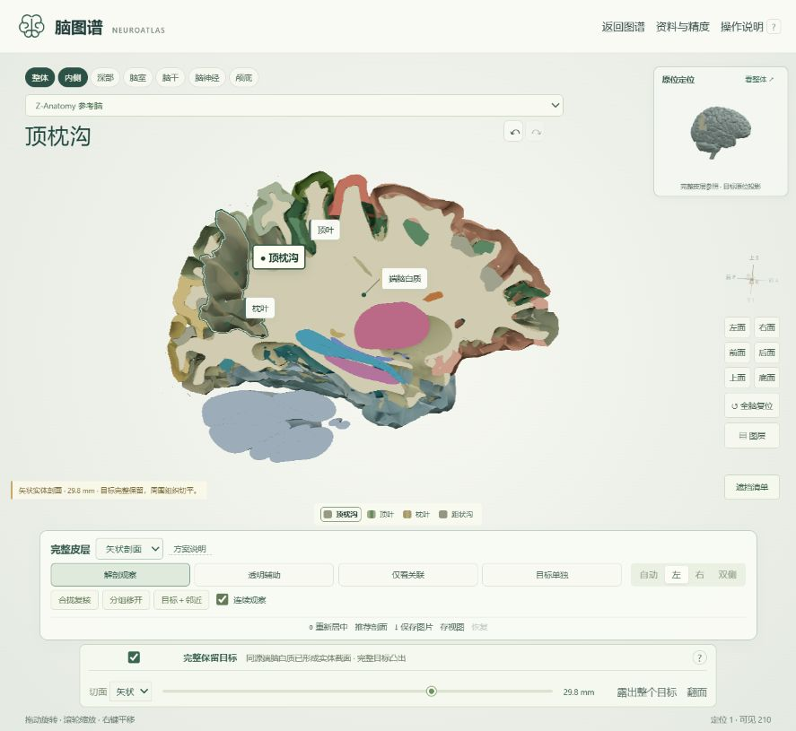

# 脑图谱 NeuroAtlas 3.2

打开 `NeuroAtlas.html` 即可使用。转发只需这个约 58 MB 的文件：模型、说明、核对图、渲染库和许可全部内嵌。三维需要支持 WebGL 的浏览器，外部参考文献链接需要联网。已有页面须重新打开或刷新才能加载本版。

[下载单文件 HTML](https://github.com/PoesisQ/NeuroATLAS/raw/refs/heads/main/NeuroAtlas.html) · [下载离线 ZIP](https://github.com/PoesisQ/NeuroATLAS/raw/refs/heads/main/NeuroAtlas-offline.zip)

从 GitHub 下载后在本地打开；GitHub 的文件预览页面不会运行三维应用。离线 ZIP 还包含说明、预览图和验证报告。



3.2 重做实体剖面：默认完整保留目标，将周围组织切平，参考脑自动带上原文件中已有的左右端脑白质与深部结构。修复分材质求交导致的封口失败、同平面截面争抢深度，以及拖动时先空壳后封口的问题。源模型数据字节没有改动；没有生成替代组织、平滑或放大变形原目标。搜索、自由旋转、分组移开、固定配色、路线与历史保持可用。

## 先定位，再打开，连续看邻接

1. 搜索“初级听觉皮层”或“岛叶”，进入 BP2018 同源场景。右上小图保留完整皮层参照，显示目标原位投影，并与主镜头同方向。
2. 主图默认使用不透明表面与实体深度遮挡。外侧沟观察窗把额顶皮层组向上、颞上回向下外侧移开；颞横回、岛叶和深部邻居保留原位。每组内部相对位置不变。“方案说明”列出移开的组织。
3. 点击标签、图例或右侧相邻结构。同一源结构始终用同一颜色；选中由深色轮廓和 ● 标签表示。默认“连续观察”沿用相邻结构的开合、切面和镜头方向；目标离开可用画面时只平移居中。点“重新居中”可重新适配目标。
4. “合拢复核”恢复各组原始坐标；“分组移开”重新打开观察窗。分离是展示动作，不表示天然组织间距或手术入路。选中已移开的脑回时，它继续留在该组位置。
5. 下拉框选择矢状、水平或冠状剖面。剖面固定在模型坐标中，旋转不会改变切面。默认勾选“完整保留目标”，目标几何不裁切，周围组织切平；“露出整个目标”把切面放到目标背后。取消勾选后目标也参与剖切，“到目标中心”用于观察内部。相邻选择保留当前切面，不会自动改色或重新合拢。

切面按原三角网格求交，同一源对象的多个材质分片一起求闭合边界；仅在量化误差范围内配对唯一的开放端点，孔洞按嵌套关系保留。参考脑已有两侧闭合端脑白质模型（源 ID 433/434），现在会用于剖面内部。其他来源没有完整白质时不跨源拼入；仍开放的源边界不补造，空白不表示解剖空腔。截面不是 MRI 或组织学纹理。

“透明辅助”保留当前开合和镜头，目标及局部关联结构保持实体，其余背景每个像素只显示最近表面，避免透明三角形层层累加。遮挡层强度可调，0% 隐去背景外表，100% 恢复前景遮挡；启用剖面时，截面始终保持实体并可点击。实线表示可见选中边界，虚线表示隔着透明前景观察的边界。点击可选透视中的实体目标；Alt + 点击可选择透明外层。透明模式中仍能分组开合。

“仅看关联”和“目标单独”沿用当前开合，不突然折回原位。“遮挡清单”可逐项隐藏对象，悬停后按 H 也可隐藏；所选对象不可隐藏。作者制作的脑沟定位面仅在直接选择该沟时显示，不再作为背景组织铺满画面。

选中轮廓按画面中的可见边界绘制，不描出所有三角网格棱边；使用轻度接触阴影增强前后层次，配色身份保持固定。深度范围随可见模型调整。渲染目标限制在约 150 万像素，静止画面复用结果；不改变源网格。极旧显卡若不支持深度纹理，透明辅助禁用，仍可使用分组移开和剖面。

左拖旋转，滚轮缩放，右拖或 Ctrl／Shift 加拖动平移。F 居中，R 复位，Ctrl K 搜索，Backspace 返回，Alt + 左／右返回／前进。单指旋转、双指缩放平移已实现，未用实体触屏实测。

返回、前进、存视图和恢复包含镜头、来源、侧别、观察方案、展开、切面、目标保护和隐藏状态。存视图仅在当前页面有效。跨源关系标记“换源”，更换整套坐标与定位小图，不假装成相邻连续运动。

推荐路线“外侧沟：由表及里”依次看入口、额岛盖、顶岛盖、前后颞横回、颞平面、岛叶中央沟与长短回。脑脊液流向示意保持手动开启，不代表真实边界或流速。

## 来源与覆盖

共有 **766 个源对象、427 个源名称、205 个课程词条、10 条路线／94 站**，4,862,565 个三角形。各版本及标本独立显示，不缩放单个结构凑位置。

| 来源空间 | 内容 | 处理与限制 |
| --- | --- | --- |
| BodyParts3D 2018 | 188 个同版本对象；完整皮层定位背景，前后颞横回、岛盖、岛短回／长回、中央沟／环状沟和有限白质分部 | 官方 20181210i412 版本，保留源面、比例与同源坐标。前颞横回每侧 6,118 面。排除 15 个重叠历史表示与 2 个源左右命名冲突对象。是解剖建模图谱，没有逐结构扫描精度保证。 |
| BodyParts3D 4.3 | 60 个对象；整体岛叶、内囊、尾状核、丘脑、壳核、苍白球及皮层背景 | 新增 36 个皮层对象，与原 24 个对象使用同一刚性转换。整体内囊用于看与丘脑、尾状核及豆状核的邻接。 |
| UW 颅底 CT | 14 个标签经左右组件分组后为 18 个对象，含圆孔、卵圆孔、棘孔、翼管与同源骨面 | 6 人合成模板手工分割；间距 0.46875 × 0.46875 × 1.25 mm。显示孔腔体积边界，**不是独立描出的真实骨缘**。 |
| NextBrain P41-16 | 29 个脑干／小脑核标签和 4 个背景标签 | 人工描绘、AI 插值并按需人工校正，作者配准至同标本 MRI；只有单半球，源接缝、开口与碎片保留。 |
| 旧参考脑 | 保留原 467 个对象 | 含上游 HCP/CIT 配准组件，保留来源和配准标记，不能保证个体位置。 |

显示轴为 +X 左、+Y 上、+Z 前。新来源只作共同刚性轴转换、平移和坐标量化，比例因子为 1。2018 与 4.3 没有做配准，不能跨版本测量距离。最大量化误差约 0.0014 mm，仅指压缩误差，**不是解剖准确度**。

## 仍有明确缺项

- BP2018 内囊只含前肢、膝、豆状核后部和下部，当前包缺独立后肢、完整尾状核头和丘脑；整体内囊切换到 4.3。2018 壳核对象是“主体部分”，没有改称完整壳核。
- 岛叶分部按官方对象显示，没有自行雕刻或划界。源个体与对称建模不能表示所有人的脑回变异；4.3 保留整体岛叶作为独立来源。
- M1、S1、V1、A1、Broca、Wernicke 是宏观定位参考。前颞横回不等于完整组织学 A1；后颞横回不能全部称 A1。
- CT 孔腔有部分容积效应，穿孔神经没有在同一 CT 模板分割。神经关系跳转换源，不把另一套神经强行插进孔腔。
- 旧骨—神经核查发现多处表面相交。走行说明与几何精度分开标记；长脑神经只有头颈显示段，没有全部分支、末梢，断端不是自然终点。
- 室间孔、Luschka/Magendie 孔、小脑镰、丘脑间黏合、嗅上皮、未分割颅底孔缘仍标为缺项。旧圆环、球形核标记、假膜片及任意坐标截取没有重新启用。
- P41 动眼核、EW、滑车核尤其小，只显示源局部标签。EW 无法区分 EWpg/EWcp；论文整体配准误差不充当逐核精度保证。保留同标本 MRI 证据图。
- 浦肯野细胞和髓树仍为单独开启的教学示意，默认不进入宏观精确场景。

没有经过独立解剖专家完整验收。新显示逻辑改善空间辨认，不能修复源数据本身的缺失或错误。

## 核验与重建

`coverage-audit.json` 逐项记录来源、关联和限制。`static-validation.json` 检查全部词条、路线、中文、二进制边界、有限坐标及每个三角形索引。`native-validation.json` 记录 2.0 基础包，3.0 增量另见 `context-validation.json`。`anatomy-validation.json` 汇集源 SHA、坐标、原拓扑、侧别及有限神经—骨相交检查。

`browser-validation.json` 记录 3.2 的实际 UI 检查；`rendering-validation.json` 对比 3.1 备份与当前内嵌数据，确认全部源模型字节未变。`section-validation.json` 包含立方体面积、多材质闭合、开放薄片拒填、环形孔洞、相切平面，以及两侧真实白质共 26 个三轴切面的检查。旧版本的广泛内容检查保存在备份 ZIP 内。没有宣称所有系统、显卡和浏览器无 bug。

内置测试浏览器安全策略拒绝 `file://`，没有绕过。采用本地 HTTP 预览和静态依赖审计；HTML 没有外部资源依赖、应用网络请求，最终使用不需要服务器。关闭服务器后继续操作已载入页面，只证明无需运行时请求，不能替代所有浏览器的首次本地加载测试。

仓库已包含生成当前 HTML 所需的压缩模型、元数据、证据图和渲染库。修改界面或讲解后，在仓库根目录运行以下命令即可重新构建；构建本身仅需要 Python 标准库，几何检查另需 Node.js：

```powershell
node source/check.cjs
node source/check_sections.cjs
python source/build.py
python source/portability.py
python source/package.py
```

原始扫描、下载归档、中间网格、依赖缓存和旧版离线备份保留在本地，未提交到 Git。`source/research-atlas` 与 `source/research-foramina` 保留采集／核验脚本、元数据及署名。若要从原始数据重新准备模型，需要先按这些脚本和来源清单补齐下载，再运行 `prepare_native.py`、`prepare_context_v3.py` 与 `source_audit.py`；这不是修改界面的必要步骤。`validate_rendering.py` 的历史几何对比另需本地 `releases/NeuroAtlas-v3.1-backup.zip`，本次已有对比结果随仓库提供。

`prepare_context_v3.py` 用 `source/v3-base` 保存基础包，避免重复叠加；更改基础源时需同步更新该构建缓存。渲染合成在 `rendering.js`，实体剖面在 `section-kernel.js` 与 `sections.js`，空间界面在 `spatial.js`、`spatial.css`、`template.html`，其他功能在 `app.js`、`upgrades.js`。用户无需运行命令。

离线包含运行文件、说明、预览和核验报告，原始数据与构建脚本留在工作目录。旧版备份在 `releases/NeuroAtlas-v1-backup.zip`、`releases/NeuroAtlas-v2-backup.zip`、`releases/NeuroAtlas-v3-backup.zip`、`releases/NeuroAtlas-v3.1-backup.zip`。

## 参考与许可

- [DBCLS 官方查看器](https://lifesciencedb.jp/bp3d/?lng=en)、[归档](https://dbarchive.biosciencedbc.jp/en/bodyparts3d/download.html)及[现行许可](https://dbarchive.biosciencedbc.jp/en/bodyparts3d/lic.html)：2025-02-27 起注明 CC BY 4.0，保留 DBCLS 署名及旧 CC BY-SA 2.1 Japan 历史声明。
- [岛叶局部解剖研究](https://pubmed.ncbi.nlm.nih.gov/10193618/)、[中央核心显微解剖研究](https://pubmed.ncbi.nlm.nih.gov/29271710/)、[颞横回与 A1 研究](https://pmc.ncbi.nlm.nih.gov/articles/PMC6623669/)支持形态与功能说明，不证明网格经过专家验收。
- [UW CT](https://hdl.handle.net/1773/46259)：Konuthula et al.，CC BY-NC-SA 3.0 United States。仅剔除数组边界的 338 个算法封口面，按原组件分侧，无新增变形。
- [NextBrain](https://github-pages.ucl.ac.uk/NextBrain/)、[P41](https://github.com/UCL/BrainAtlas-P41-16)、[DOI](https://doi.org/10.5522/04/24243835.v1)：CC0-1.0，固定提交 `9c29e15e2eef6db902296f53de636d57fc5aa6a1`。没有平滑、补洞、镜像或跨图谱拟合源目标。
- [Brain Project](https://github.com/itayinbarr/brainproject) 和 [Z-Anatomy 补充导出](https://github.com/nqwrc/3d-anatomy) 保留 CC BY-SA、BodyParts3D、Dundee CAHID 及配准来源署名。补充提交 `8ca3b7421bcfbe88b85859eb1983d5cf79f21749`。
- 界面与脚本、Three.js、fflate 使用 MIT；模型遵守各来源许可。最终文件含 UW 非商业、相同方式共享组件，不把模型重新许可为 MIT。完整许可与署名内嵌在 HTML 的 `bundledLicenses`。

全部为公开参考数据，没有使用用户私人影像。


透明材质程序更新与深度排序依据 [Three.js 更新说明](https://threejs.org/manual/pages/how-to-update-things.html)及[透明渲染说明](https://threejs.org/manual/pages/transparency.html)。本文件继续内嵌原 Three.js r160，无运行时外部依赖。

剖面材质与深度写入参考 [Three.js Material 文档](https://threejs.org/docs/pages/Material.html)。重叠标签的截面按稳定次序着色，随后单独写入截面深度，不平移源组织来避免显示闪烁。
